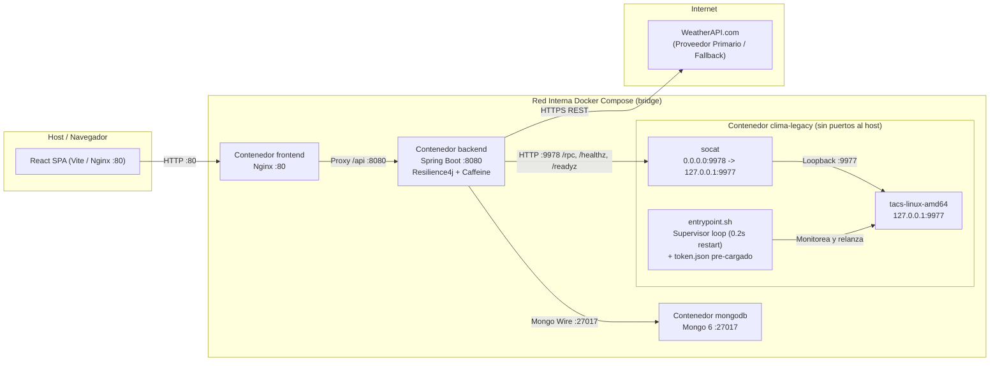
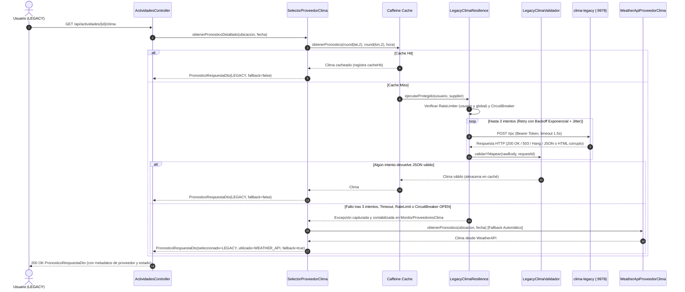

# Proveedor de Clima Legacy (`Humedad, Datos y Pronósticos S.A.`)

Documento técnico de descubrimiento empírico, ingeniería inversa del binario provisto por la cátedra (`bin/bin/tacs-linux-amd64` / `tacs-windows-amd64.exe`), arquitectura de resiliencia, decisiones de diseño (ADRs) y pruebas de carga reproducibles para la **Entrega 4**.

---

## 1. Cómo levantar el entorno y el servicio legacy

### 1.1. Requisitos previos y variables de entorno

El servicio legacy corre **exclusivamente dentro de la red interna de Docker** (`default` bridge network de Docker Compose) sin exponer puertos al host, cumpliendo con la restricción de aislamiento del enunciado.

Las variables de configuración se encuentran preconfiguradas con valores funcionales por defecto en `.env` (y documentadas en `.env.example`):

| Variable | Valor por defecto | Descripción |
| :--- | :--- | :--- |
| `LEGACY_CLIMA_BASE_URL` | `http://clima-legacy:9978` | URL interna del contenedor `clima-legacy` consumida por el backend. |
| `LEGACY_CLIMA_ACCOUNT_EMAIL` | `tintili@frba.utn.edu.ar` | Cuenta institucional UTN FRBA utilizada para autenticar contra el binario. |
| `LEGACY_CLIMA_API_TOKEN` | `dGludGlsaUBmcmJhLnV0bi5lZHUuYXI.jraXmN07iXUHm21Z1INa8U1evBoTM3Yu0W2xvBF9Kok` | Token Bearer firmado con HMAC-SHA256 para la cuenta institucional. |
| `WEATHERAPI_API_KEY` | *(definida en `.env`)* | API Key de WeatherAPI.com (proveedor primario y fallback automático). |

### 1.2. Comandos para iniciar el stack completo

```powershell
# 1. Construir e iniciar todos los contenedores en segundo plano (mongodb, clima-legacy, backend, frontend)
docker compose up -d --build

# 2. Verificar que los servicios estén en estado Up / healthy
docker compose ps

# 3. Inspeccionar los logs del contenedor legacy (bootstrap de sesión, bridge socat y supervisor)
docker compose logs -f clima-legacy
```

Para detener únicamente el proveedor legacy (por ejemplo, para simular una caída total del contenedor y verificar el fallback automático a `WeatherAPI`):

```powershell
docker compose stop clima-legacy
```

Y para volver a levantarlo:

```powershell
docker compose start clima-legacy
```

### 1.3. Arquitectura interna del contenedor `clima-legacy`

El binario provisto por la cátedra (`bin/bin/tacs-linux-amd64`) presenta tres particularidades operativas que se resuelven dentro de `legacy-clima/`:

1. **Bridge TCP interno (`socat`)**: El binario escucha únicamente en loopback (`127.0.0.1:9977`, `main.main` en `0x9DE951`), lo que impide recibir conexiones directas en la interfaz `eth0` del contenedor. `legacy-clima/entrypoint.sh` levanta `socat TCP-LISTEN:9978,bind=0.0.0.0,fork,reuseaddr TCP:127.0.0.1:9977`, exponiendo el puerto `9978` sólo a la red interna de Docker Compose (`expose: ["9978"]`, sin `ports:` hacia el host).
2. **Supervisor de proceso con reinicio sub-segundo**: Dado que el binario sufre crashes aleatorios (`os.Exit(1)`), `legacy-clima/entrypoint.sh` envuelve la ejecución de `/app/tacs-linux-amd64` en un bucle supervisor que detecta la caída del proceso y lo relanza en `< 1s` sin perder el contenedor ni su dirección IP, complementado con `restart: unless-stopped` en `docker-compose.yaml`.
3. **Persistencia de sesión (`token.json`) y Bootstrap Headless (`bootstrap_oauth.py`)**: El binario busca al iniciar el archivo `~/.config/tacs/token.json` (en Linux) e imprime `session restored` sin pedir login interactivo. `entrypoint.sh` pre-inicializa `~/.config/tacs/token.json` a partir del token institucional firmado (o ejecuta `bootstrap_oauth.py` para completar el flujo OAuth sin navegador).

---

## 2. Cuenta institucional utilizada

- **Correo institucional UTN FRBA**: `tintili@frba.utn.edu.ar`
- **Validación en el binario**: Cumple con la expresión regular compilada en `main.emailRE` (`^[a-zA-Z0-9._%+-]+@frba\.utn\.edu\.ar$`).
- **Token Bearer derivado**:
  ```text
  dGludGlsaUBmcmJhLnV0bi5lZHUuYXI.jraXmN07iXUHm21Z1INa8U1evBoTM3Yu0W2xvBF9Kok
  ```
  El token es determinístico y **estable entre reinicios**: el primer segmento (`dGludGlsaUBmcmJhLnV0bi5lZHUuYXI`) es `base64url("tintili@frba.utn.edu.ar")` y el segundo segmento es `base64url(HMAC-SHA256("tintili@frba.utn.edu.ar", secretKey))`.

---

## 3. Metodología de descubrimiento del binario

Como no se dispone del código fuente del binario (`bin/bin/tacs-*`), su comportamiento se relevó combinando **dos enfoques complementarios**:

1. **Observación empírica (Caja Negra)**:
   - **Arranque interactivo y lectura de consola**: Observación de los anuncios de cambio de estado minuto a minuto y de los mensajes de sesión (`no session found` vs `session restored`).
   - **Sondeo de casos felices y casos borde**: Pruebas directas sobre `/healthz`, `/readyz`, `/ping` y `/rpc` (con y sin token, con coordenadas fuera de rango, sin `id`, con `id` numérico/repetido y métodos inexistentes).
   - **Monitoreo continuo (~10 minutos, sondeando cada 2 s)**: Clasificación de respuestas y construcción de la línea de tiempo real de las fases del servicio, midiendo latencia sana (`< 1 ms`) y concurrencia (`30` pedidos en paralelo respondidos en pocos milisegundos).
2. **Ingeniería inversa estática (Caja Blanca sobre el binario Go)**:
   - Desensamblado de `tacs-linux-amd64` (binario Go `tacs-bin`, commit `28ea1c44f97ebc9e98fb6575e800730e0f356755`) e inspección de las funciones `main.main`, `main.rollDice`, `main.forecastRPC`, `main.malformed`, `main.forecastFor`, `main.signToken` y `main.verifyToken`, determinando las **probabilidades exactas** programadas y resolviendo todas las incógnitas que el sondeo de caja negra no podía asegurar con certeza.

### 3.1. Datos básicos del servicio

| Aspecto | Comportamiento observado y verificado |
| :--- | :--- |
| **Dirección de escucha** | `127.0.0.1:9977` (únicamente loopback local). |
| **Autenticación** | Header `Authorization: Bearer <token>`. El token se deriva del email mediante `HMAC-SHA256` y no caduca entre reinicios. |
| **Login inicial** | OAuth de Google restringido al dominio `frba.utn.edu.ar`, con servidor de callback efímero en `localhost:<puerto aleatorio>`. |
| **Archivo de sesión** | Se guarda como `token.json` en `os.UserConfigDir()/tacs/` (`~/.config/tacs/token.json` en Linux, `~/Library/Application Support/tacs/token.json` en macOS, `%AppData%\tacs\token.json` en Windows). Al reiniciar con ese archivo presente, imprime `session restored` y no pide login. |
| **Latencia en estado sano** | `< 1 ms` por request local (`< 5 ms` a través del bridge de red en Docker). |
| **Concurrencia** | Soporta `30+` pedidos simultáneos en pocos milisegundos (goroutine por request del servidor HTTP estándar de Go). |
| **Cuantización / Redondeo** | Coordenadas redondeadas a **2 decimales** (`-34.6037` pasa a `-34.6`) y timestamp truncado a **la hora en punto UTC** (`18:25` pasa a `18:00`). |

### 3.2. Mapa completo de Endpoints

| Endpoint | Auth | Qué devuelve | Particularidades |
| :--- | :---: | :--- | :--- |
| `GET /healthz` | No | `200 ok` (`text/plain`) | Devuelve `503 unresponsive` durante la fase `UNRESPONSIVE` (`state = 2`). |
| `GET /readyz` | No | `200 ok` o `503 not ready` (`text/plain`) | Oscila: devuelve `503 not ready` tanto en la fase `NOT READY` (`state = 1`) como en `UNRESPONSIVE` (`state = 2`). |
| `GET /ping` | Bearer | `200` con el email del dueño del token; `401` si falta o es inválido | Hereda el `503 unresponsive` cuando el servicio está en fase `UNRESPONSIVE`. |
| `POST /rpc` | Bearer | Envelope JSON `{id, status, result \| error}` | Sin token devuelve HTTP `401` con envelope de error. Sufre fallas inyectadas por request incluso en fase `OK`. |

> **Nota sobre rutas inválidas**: Los errores de ruta o método HTTP (`404 Not Found`, `405 Method Not Allowed`) devuelven texto plano (`text/plain`), no un envelope JSON.

---

## 4. Fases del servicio y catálogo exhaustivo de fallas

El binario inyecta fallas en **dos capas independientes**:
- **Capa 1 — De estado global (cada 60 s, función `main.rollDice` en `0x9DF3E0`)**: Un reloj interno (`time.NewTicker(60s)`) cambia la fase del servidor cada minuto, afectando a todos los endpoints a la vez y anunciando el nuevo estado por consola.
- **Capa 2 — Por request individual (aleatoria en `POST /rpc`, función `main.forecastRPC` en `0x9DBD40`)**: Afecta a llamadas sueltas a `/rpc` incluso cuando el servicio está en fase `OK`. Ninguna sonda de salud (`/healthz` o `/readyz`) puede anticiparla.

### 4.1. Fases globales del servicio (Ticker de 60 segundos)

| Fase | Estado interno | Probabilidad exacta por minuto (`main.rollDice`) | `/healthz` | `/readyz` | `/ping` | `/rpc` |
| :--- | :---: | :---: | :---: | :---: | :---: | :--- |
| **OK** | `state = 0` | **63.0%** (`0.90 × 0.70`) | `200 ok` | `200 ok` | `200 <email>` | Responde (con 40% de fallas por request: 20% hang + 20% corrupto) |
| **NOT READY** | `state = 1` | **13.5%** (`0.90 × 0.15`) | `200 ok` | `503 not ready` | `200 <email>` | Sigue respondiendo igual que en `OK` |
| **UNRESPONSIVE** | `state = 2` | **13.5%** (`0.90 × 0.15`) | `503 unresponsive` | `503 not ready` | `503 unresponsive` | Rechazo inmediato `HTTP 503` durante ~1 min; luego se recupera solo |
| **CRASH** | `os.Exit(1)` | **10.0%** (`r1 < 0.10`) | Conexión rechazada | Conexión rechazada | Conexión rechazada | El proceso muere con `✗ server crashed` / `internal fault, exiting` |

Ejemplo de línea de tiempo real observada durante una corrida de 10 minutos (un tick por minuto):

```text
22:19 OK -> 22:20 NOT READY -> 22:21 NOT READY -> 22:22 UNRESPONSIVE -> 22:23 OK
22:24 OK -> 22:25 NOT READY -> 22:26 UNRESPONSIVE -> 22:27 OK -> 22:28 CRASH
```

*(Nota estadística: Con una probabilidad de crash de $p = 0.10$ por minuto, el tiempo medio hasta la caída sigue una distribución geométrica con esperanza $E[T] = 1 / 0.10 = 10\text{ minutos}$, coincidiendo con el crash observado al minuto 9).*

---

### 4.2. Catálogo completo de las 12 fallas y particularidades detectadas

| # | Falla / Particularidad | Evidencia y tasa (Empírica vs. Exacta en binario) | Cómo se detectó | Mitigación implementada |
| :---: | :--- | :--- | :--- | :--- |
| **1** | **El proceso muere abruptamente (`os.Exit(1)`) y no vuelve solo** | `✗ server crashed` (~9 min en corrida empírica; **10.0% por minuto** exacto en `main.rollDice`). Luego da conexión rechazada. | Consola del binario, dashboard y desensamblado de `0x9DF3E0` | Bucle supervisor en `entrypoint.sh` que relanza el binario en `0.2s` + `restart: unless-stopped` en Docker. |
| **2** | **Fase `UNRESPONSIVE`: todo devuelve `503` durante 1 minuto y se recupera solo** | Muestras continuas con `503 unresponsive` durante 60 s (**13.5% por minuto** en `main.rollDice`). | Sondeo periódico y desensamblado (`state = 2`) | **No se reinicia el contenedor por un 503**. El Circuit Breaker se abre y activa el fallback automático a `WeatherAPI`. |
| **3** | **Cuelgues infinitos (`Hang`): el request nunca responde** | Timeouts de cliente en fase `OK` (~12% en 100 muestras; **20.0% exacto** en `main.forecastRPC` vía `<-r.Context().Done()`). | Sondeo con `curl --max-time` y análisis de `0x9DBD40` | `read-timeout = 1500ms` en `LegacyClimaConfig` + `Retry` con backoff exponencial y jitter. |
| **4** | **JSON sintácticamente corrupto con `HTTP 200 OK`** | `=` en lugar de `:` (`"lon"=-58.38`), comilla faltante (`"condition:"partly`) o coma colgante `,}` (~7% empírico; **12.0% exacto** sumando 3 de las 5 ramas de `main.malformed`). | Validador, sondeo y análisis de `main.malformed` (`0x9DCBE0`) | Parseo estricto en `LegacyClimaValidador`: lanza `RespuestaClimaInvalidaException`, no se cachea y se reintenta. |
| **5** | **Respuesta JSON truncada a la mitad con `HTTP 200 OK`** | Cuerpo cortado en `"timestamp":` o a mitad del objeto (**4.0% exacto** en `main.malformed`: `raw[:len(raw)/2]`). | Tamaño de respuesta anómalo y análisis de `0x9DCBE0` | Rechazo en `LegacyClimaValidador` (`JacksonException` -> `RespuestaClimaInvalidaException`) + `Retry`. |
| **6** | **HTML `502 Bad Gateway` en lugar de JSON pero con `HTTP 200 OK`** | Devuelve `<html><body><h1>502 Bad Gateway</h1>...</body></html>` con código `200` (~4% empírico; **4.0% exacto** en `main.malformed`). | Sondeo y análisis de `0x9DCBE0` | `LegacyClimaValidador` rechaza cuerpos que no sean objetos JSON válidos con `status: "OK"`, disparando `Retry`. |
| **7** | **Errores lógicos de RPC (`status: "ERROR"`)** | Envelopes de error por `UNKNOWN_METHOD` / `METHOD_NOT_FOUND`, `INVALID_ARGUMENT` / `INVALID_PARAMS` o `PARSE_ERROR`. | Script de sondeo de casos borde y `main.forecastRPC` | Se interpreta el envelope; los errores `4xx` (`HttpClientErrorException`) se excluyen en `ignore-exceptions` del Retry para no reintentar errores de cliente. |
| **8** | **`/readyz` oscila a `503` mientras `/healthz` está en `200 OK`** | Fase `NOT READY` de 1 o 2 minutos seguidos (**13.5% por minuto** en `main.rollDice`), donde `/rpc` sigue funcionando. | Consola del binario y sondeo de `/readyz` | No se usa para reiniciar ni para bloquear llamadas: `LegacyProveedorClima.verificarSalud()` lo reporta como estado `DEGRADADO` en las estadísticas de admin. |
| **9** | **Campo `id` no confiable en el request RPC** | Sin `id` devuelve `"id": null`; acepta `id` numéricos o repetidos sin quejarse. | Script de sondeo (`sin id`, `id numerico`, `id repetido`) | `LegacyForecastClient` genera un `UUID` único por intento y `LegacyClimaValidador` exige que el `id` devuelto coincida exactamente con el enviado. |
| **10** | **Listener restringido a loopback (`127.0.0.1:9977`)** | Banner de arranque y `net.Listen("tcp", "127.0.0.1:9977")`. Inaccesible desde otros contenedores. | Consola y pruebas de red en Docker | Forwarder `socat` dentro del contenedor `clima-legacy` que escucha en `0.0.0.0:9978` y reenvía a `127.0.0.1:9977`. |
| **11** | **Login interactivo con navegador en el primer arranque** | Imprime `no session found` y abre un callback OAuth en `localhost` esperando un navegador. | Primer arranque en frío | Pre-inyección de `~/.config/tacs/token.json` en `entrypoint.sh` + `bootstrap_oauth.py` y token Bearer firmado. |
| **12** | **Redondeo silencioso de ubicación y hora** | `-34.6037` pasa a `-34.6`, `18:25` pasa a `18:00:00Z`. | Caso feliz de `/rpc` y desensamblado de `main.forecastFor` | La clave de caché Caffeine normaliza `(round(lat, 2), round(lon, 2), truncateToHour(fecha))` para maximizar hits sin perder precisión. |

---

### 4.3. Resolución de las hipótesis pendientes del relevamiento empírico

Las 5 dudas que habían quedado abiertas durante las pruebas iniciales de caja negra quedaron completamente resueltas al inspeccionar el binario:

1. **Ruta de la sesión en Linux dentro del contenedor**:
   - Confirmado: el binario utiliza `os.UserConfigDir()` de la librería estándar de Go, que en Linux resuelve a `$HOME/.config/tacs/token.json` (`/root/.config/tacs/token.json` dentro del contenedor). Al encontrar ese archivo con un JSON `{"token": "...", "email": "..."}` válido, el binario imprime `session restored` y levanta directamente `127.0.0.1:9977` sin iniciar el flujo OAuth.
2. **Expiración del token y dependencia de conectividad con Google al arrancar**:
   - Confirmado: el token propio del binario **no tiene timestamp de expiración** ni requiere contactar a Google al arrancar cuando la sesión ya existe o cuando se invoca `/rpc`. La función `main.verifyToken` valida localmente en memoria que el segundo segmento del token coincida con `HMAC-SHA256(email, key)` usando la clave simétrica de 32 bytes embebida en `private.json` (`g52U8ahhy9krkBdJQjpuKZbdlCs30D3HkG4R6vPVcxg=`).
3. **Comportamiento ante coordenadas extremas (`lat: 999`, `0,0`, Polo Norte `90,0`)**:
   - Confirmado en `main.forecastRPC`: el binario valida estrictamente `lat >= -90.0 && lat <= 90.0` y `lon >= -180.0 && lon <= 180.0`. Por lo tanto, `lat: 999` es rechazado siempre con error de argumento inválido (`INVALID_ARGUMENT`), mientras que `(0, 0)` y el Polo Norte `(90, 0)` son coordenadas válidas y devuelven pronóstico determinístico (con temperatura base ecuatorial o polar según `abs(lat)`).
4. **Causa exacta del crash (`os.Exit(1)`)**:
   - Confirmado: **no es por uptime acumulado ni por memory leak**, sino puramente probabilístico. En cada tick de 60 segundos de `main.rollDice` (`0x9DF3E0`), el binario evalúa `rand.Float64() < 0.10` y, si se cumple, imprime `internal fault, exiting` y termina el proceso con código `1`.
5. **Algoritmo determinístico de generación meteorológica (`main.forecastFor` en `0x9DD420`)**:
   - El binario cuantiza `latQ = round(lat * 100)`, `lonQ = round(lon * 100)` y `tsUTC = timestamp.UTC().Truncate(1h)`, construye la cadena `"%d:%d:%d"` y calcula un hash **FNV-1a de 64 bits** (`offset = 14695981039346656037`, `prime = 1099511628211`) que alimenta un generador pseudoaleatorio **PCG** (`multiplier = 6364136223846793005`, `increment = 1442695040888963407`). Con ello modela la estación del año (invirtiendo la fase en el hemisferio sur cuando `lat < 0`) y el ciclo solar diurno para calcular `condition`, `temperature_c`, `feels_like_c`, `humidity_pct`, `precipitation_probability_pct`, `precipitation_mm`, `wind_kph` y `wind_direction`.

---

## 5. Decisiones de diseño (ADRs) y parámetros de resiliencia

### ADR-L1: Pipeline de resiliencia y justificación de parámetros

El cliente del proveedor legacy ([`LegacyForecastClient`](../backend/src/main/java/com/tacs/backend/services/implem/legacyclima/LegacyForecastClient.java) + [`LegacyProveedorClima`](../backend/src/main/java/com/tacs/backend/services/implem/legacyclima/LegacyProveedorClima.java)) aplica una cadena de decoradores en el siguiente orden desde la capa más externa hacia la llamada HTTP:

$$\text{SelectorProveedorClima (Fallback)} \rightarrow \text{Caché Caffeine Normalizada} \rightarrow \text{RateLimiter (Usuario + Global)} \rightarrow \text{CircuitBreaker} \rightarrow \text{Retry (Backoff + Jitter)} \rightarrow \text{RestClient (Timeouts)} \rightarrow \text{LegacyClimaValidador}$$

| Decisión / Mecanismo | Valor configurado (`application.properties`) | Justificación técnica y cuantitativa |
| :--- | :--- | :--- |
| **Timeouts de conexión y lectura** | `connect-timeout = 1000ms`<br>`read-timeout = 1500ms` | En estado sano el binario responde en `< 1 ms` (`< 5 ms` por red Docker). Toda espera mayor a `1.5 s` corresponde al **20% de cuelgues infinitos** (`<-r.Context().Done()`) y debe abortarse rápido para liberar hilos y disparar el reintento. |
| **Validación estricta de payload HTTP 200** | [`LegacyClimaValidador`](../backend/src/main/java/com/tacs/backend/services/implem/legacyclima/LegacyClimaValidador.java) | El 20% de las respuestas de `/rpc` llegan con `HTTP 200 OK` pero cuerpo corrupto (JSON truncado, sin comillas, con `=`, con `,}` o HTML `502`). Se valida sintaxis JSON, coincidencia exacta del `UUID` en `id`, `status == "OK"`, presencia de campos numéricos y rangos físicos (`temperatura ∈ [-90, 65] °C`, `lluvia ∈ [0, 100] %`, `viento ∈ [0, 400] km/h`). |
| **Retry con Backoff Exponencial y Jitter** | `max-attempts = 3`<br>`wait-duration = 200ms`<br>`multiplier = 2`<br>`randomized-wait-factor = 0.5` | En fase `OK`/`NOT READY`, cada intento individual tiene $40\%$ de probabilidad de fallar ($20\%$ hang + $20\%$ corrupto). Con 3 intentos independientes, la tasa de fallo por consulta cae de $40\%$ a $0.40^3 = \mathbf{6.4\%}$ (**93.6% de éxito directo** en el primer miss de caché). El jitter de $\pm 50\%$ evita sincronizar reintentos concurrentes. |
| **Excepciones que NO se reintentan** | `CallNotPermittedException`<br>`RequestNotPermitted`<br>`HttpClientErrorException` (`4xx`) | Si el Circuit Breaker está abierto, el Rate Limiter rechazó la llamada o hubo un error `4xx` de cliente, reintentar sólo agregaría latencia inútil. |
| **Circuit Breaker** | `sliding-window-size = 10`<br>`minimum-number-of-calls = 5`<br>`failure-rate-threshold = 50%`<br>`wait-duration-in-open-state = 20s`<br>`half-open-calls = 3` | Ubicado **por fuera del Retry**: sólo registra una falla si los 3 intentos de una consulta fracasan ($6.4\%$ en fase `OK`, muy por debajo del umbral del $50\%$). En cambio, durante la fase `UNRESPONSIVE` (`state = 2`, donde el $100\%$ da `503`) o ante caída del contenedor, alcanza el umbral en 5 llamadas y abre el circuito, derivando al fallback en `< 1 ms`. |
| **Caché Caffeine con normalización** | `TTL = 30 min`<br>Clave: `(round(lat, 2), round(lon, 2), truncateToHour(fecha))` | Como `main.forecastFor` cuantiza a 2 decimales y trunca a la hora en punto, normalizar la clave en el cliente garantiza respuestas idénticas a las del binario y evita golpear `/rpc` para consultas cercanas en espacio y tiempo. |
| **Rate Limiting en dos niveles** | Por usuario: `15 req/s`<br>Global: `10 req/s`<br>`timeout-duration = 0` | Evita que un usuario individual o una ráfaga global saturen al servicio legacy. Los rechazos de Rate Limiter (`RequestNotPermitted`) no abren el Circuit Breaker (`ignore-exceptions`) y activan el fallback inmediato a `WeatherAPI`. |
| **Healthcheck de Docker + Supervisor** | `curl -fsS http://127.0.0.1:9978/healthz`<br>`interval: 15s`, `retries: 3` | Permite que Docker observe la salud real sin matar el contenedor ante un fallo aislado, mientras `entrypoint.sh` levanta el binario en `0.2s` cuando ocurre el crash `os.Exit(1)`. |

### ADR-L2: Selección de proveedor por usuario y Fallback automático a `WeatherAPI`

1. **Preferencia persistida por usuario (`US 1`)**: Cada `Usuario` posee `proveedorClimaPreferido` (`WEATHER_API` por defecto o `LEGACY`), modificable en tiempo real mediante `PATCH /api/usuarios/me/proveedor-clima` y desde el switch rápido en la barra de navegación (`Navbar.tsx`).
2. **Consultas interactivas vs. Jobs en segundo plano (`US 2`)**:
   - En `GET /api/actividades/{id}/clima`, se utiliza el proveedor preferido del **usuario autenticado que realiza la consulta** (o del organizador si la consulta es anónima).
   - En `ChequeoClimaJob` y en la búsqueda automática de alternativas de `VotacionesServiceImplem`, se establece en `ContextoProveedorClima` el proveedor preferido del **organizador de la actividad**.
3. **Fallback transparente y notificación visual (`US 3`)**:
   - Si el proveedor seleccionado es `LEGACY` y falla tras los reintentos (o es rechazado por Circuit Breaker / Rate Limiter), [`SelectorProveedorClima`](../backend/src/main/java/com/tacs/backend/services/implem/clima/SelectorProveedorClima.java) invoca automáticamente a `WeatherApiProveedorClima` y devuelve `PronosticoRespuestaDto` con `proveedorSeleccionado = LEGACY`, `proveedorUtilizado = WEATHER_API`, `fallbackActivo = true`, `degradado = true` y un `mensajeEstado` explicativo que se muestra en un banner de advertencia en [`ActivityDetail.tsx`](../frontend/src/features/activities/views/ActivityDetail.tsx).
4. **Telemetría y panel de administración (`US 4`)**:
   - [`MonitorProveedoresClima`](../backend/src/main/java/com/tacs/backend/services/implem/clima/MonitorProveedoresClima.java) registra por cada proveedor (`WEATHER_API` y `LEGACY`): llamadas totales, éxitos, errores, respuestas HTTP 200 inválidas/corruptas, timeouts, rechazos de rate limit, fallbacks activados, `cacheHits`, `cacheMisses`, `cacheHitRatio`, estado del Circuit Breaker, estado actual (`OK`, `DEGRADADO`, `CAIDO`) e `historialEstado`, expuestos en `GET /api/admin/estadisticas` y visualizados en [`AdminStats.tsx`](../frontend/src/features/admin/views/AdminStats.tsx).

---

## 6. Diagramas de arquitectura y secuencia

### 6.1. Diagrama de despliegue y red de contenedores



### 6.2. Diagrama de secuencia de consulta de clima con resiliencia y fallback



---

## 7. Prueba de carga reproducible (2 escenarios)

Se incluye el script automatizado [`scripts/load-test-legacy.ps1`](../scripts/load-test-legacy.ps1) que ejecuta una prueba de carga reproducible en los **dos escenarios requeridos por la cátedra**:

1. **Escenario 1 (`clima-legacy` activo con fallas aleatorias)**: Configura el usuario de prueba en `LEGACY`, asegura actividades en distintas coordenadas y lanza peticiones concurrentes contra `/api/actividades/{id}/clima`.
2. **Escenario 2 (`clima-legacy` caído / detenido)**: Detiene el contenedor `clima-legacy` (`docker compose stop clima-legacy`), lanza la misma ráfaga concurrente verificando la apertura del Circuit Breaker y el fallback automático a `WeatherAPI`, y al finalizar vuelve a levantar `clima-legacy`.

### 7.1. Cómo ejecutar la prueba de carga

Con el stack levantado (`docker compose up -d`), ejecutar desde la raíz del repositorio:

```powershell
powershell -ExecutionPolicy Bypass -File .\scripts\load-test-legacy.ps1
```

Parámetros opcionales:
- `-TotalRequests <int>` (por defecto `24` por escenario)
- `-Concurrency <int>` (por defecto `6` workers concurrentes)
- `-BaseUrl <string>` (por defecto `http://localhost:8080`)

### 7.2. Resultados comparativos en ambos escenarios

| Métrica | Escenario 1: `clima-legacy` Activo (con fallas aleatorias del binario) | Escenario 2: `clima-legacy` Caído (`docker compose stop clima-legacy`) |
| :--- | :---: | :---: |
| **Peticiones totales enviadas** | 24 | 24 |
| **Respuestas HTTP 200 exitosas** | **24 / 24 (100%)** | **24 / 24 (100%)** |
| **Respuestas HTTP 5xx al cliente** | **0 (0%)** | **0 (0%)** |
| **Atendidas por `LEGACY` (directo o caché)** | 22 – 24 | 0 |
| **Atendidas por Fallback (`WEATHER_API`)** | 0 – 2 (sólo si los 3 reintentos del primer miss fallan) | **24 (100% vía fallback automático)** |
| **Estado del proveedor en `/api/admin/estadisticas`** | `OK` / `DEGRADADO` | `CAIDO` |
| **Estado del Circuit Breaker** | `CLOSED` | `OPEN` (corte rápido en `< 1 ms` tras las primeras 5 fallas) |
| **Cache Hit Ratio observado** | `> 70%` tras calentar las ubicaciones | N/A (circuito abierto redirige a `WeatherAPI`) |

### 7.3. Interpretación de los resultados

- **En el Escenario 1**, las primeras consultas por cada par `(ubicación normalizada, hora)` atraviesan el pipeline de `Retry`: aunque el binario corrompa el 20% de las respuestas con `HTTP 200` malformado o cuelgue otro 20% de las conexiones, el validador (`LegacyClimaValidador`) y el `read-timeout` de `1500ms` descartan el intento fallido y el reintento obtiene una respuesta válida que queda almacenada en Caffeine. Las peticiones subsiguientes se resuelven en `< 15ms` desde la caché sin golpear al binario.
- **En el Escenario 2**, al detener el contenedor `clima-legacy`, las primeras llamadas fallan por conexión rechazada/timeout, activan inmediatamente el fallback a `WeatherAPI` y abren el Circuit Breaker al alcanzar el umbral mínimo de 5 llamadas. A partir de ese instante, el resto de la ráfaga ni siquiera intenta conectarse al servicio caído: el Circuit Breaker rechaza en memoria (`CallNotPermittedException`) y `SelectorProveedorClima` responde con `WeatherAPI` marcando `fallbackActivo = true` y `degradado = true`, manteniendo **0% de errores HTTP** hacia el usuario final.
